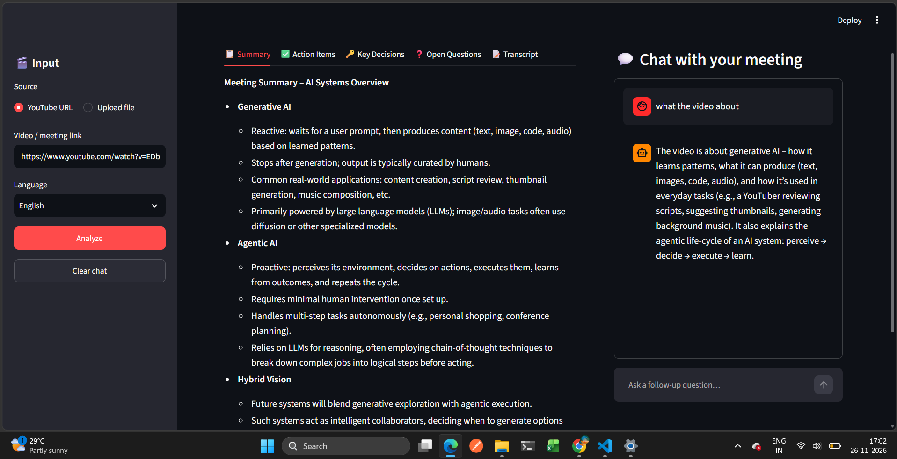
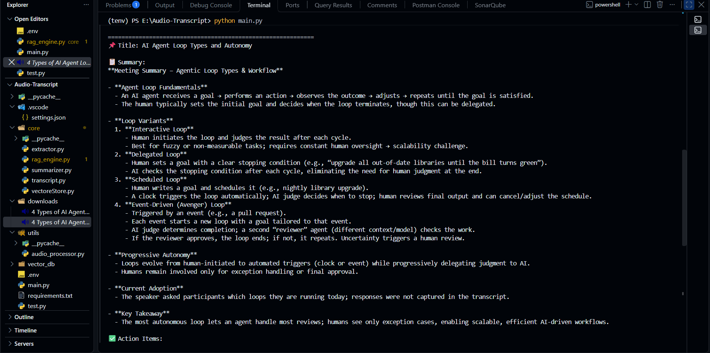
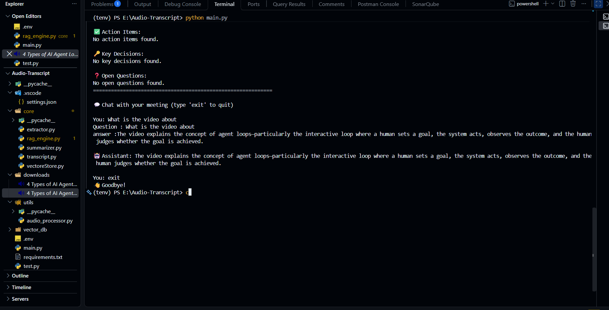

# AI Meeting & Video Assistant

An end-to-end Python pipeline that takes a **YouTube URL** or **local audio/video file**, transcribes it (using local **OpenAI Whisper** for English or **Sarvam AI** for Hinglish), generates a **title, summary, action items, key decisions, and open questions** via **Groq + LangChain**, and lets you **chat with the transcript** using a local **ChromaDB RAG** pipeline.

---

## Features

- **Flexible Audio Acquisition (`utils/audio_processor.py`)**:
  - Downloads audio from YouTube URLs using `yt-dlp`.
  - Converts local audio/video files to 16 kHz mono WAV via `pydub` + `ffmpeg`.
  - Splits long audio into 10-minute chunks for reliable transcription.
- **Dual-Engine Transcription (`core/transcript.py`)**:
  - `english`: Runs **OpenAI Whisper** locally (`WHISPER_MODEL`, default `small`).
  - `hinglish`: Uses **Sarvam AI** (`saaras` speech-to-text-translate API), automatically slicing audio into 25-second pieces to respect the 30-second sync API limit.
- **Summarization & Title Generation (`core/summarizer.py`)**:
  - Map-reduce summarization using `RecursiveCharacterTextSplitter` and **Groq** (`ChatGroq`) via LangChain LCEL.
- **Structured Insights Extraction (`core/extractor.py`)**:
  - Extracts **Action Items** (task, owner, deadline), **Key Decisions**, and **Open Questions**.
- **Interactive RAG Q&A (`core/vectoreStore.py` & `core/rag_engine.py`)**:
  - Embeds transcript chunks with `all-MiniLM-L6-v2` (`langchain-huggingface`) and stores them in **ChromaDB** (`vector_db/`).
  - Answers follow-up questions grounded strictly in the meeting transcript.
- **Streamlit Web UI (`app.py`)**:
  - Supports pasting a YouTube URL or uploading local audio/video files (`mp4`, `mkv`, `mov`, `webm`, `avi`, `mp3`, `wav`, `m4a`), with tabbed views for Summary, Action Items, Key Decisions, Open Questions, Transcript, and a live chat panel.

---

## Project Structure

```text
Audio-Transcript/
├── .streamlit/
│   └── config.toml            # Streamlit dark theme, minimal toolbar & 1000 MB upload limit
├── assets/
│   ├── console-output-1.png   # Sample CLI output: Title & Summary
│   ├── console-output-2.png   # Sample CLI output: Extraction & RAG Q&A
│   └── streamlit-ui.png       # Sample Streamlit Web UI
├── core/
│   ├── extractor.py           # Action items, key decisions, open questions
│   ├── rag_engine.py          # LCEL RAG chain & Q&A interface
│   ├── summarizer.py          # Map-reduce summary & title generator
│   ├── transcript.py          # Whisper (English) & Sarvam AI (Hinglish)
│   └── vectoreStore.py        # HuggingFace embeddings & ChromaDB store
├── utils/
│   └── audio_processor.py     # YouTube download, WAV conversion, chunking
├── app.py                     # Streamlit web interface
├── main.py                    # CLI pipeline + interactive RAG chat
├── test.py                    # Quick test script (without RAG chat loop)
├── requirements.txt           # Python dependencies
├── .env                       # API keys & model config (ignored by git)
└── .gitignore
```

---

## Prerequisites

- **Python 3.10+** (if using Python 3.13+, `audioop-lts` is included in `requirements.txt` for `pydub` compatibility)
- **FFmpeg** (`ffmpeg` and `ffprobe` available on `PATH`):
  - Conda: `conda install -c conda-forge ffmpeg -y`
  - Winget (Windows): `winget install Gyan.FFmpeg`

---

## Setup & Installation

1. **Clone the repository** and navigate into the project directory:
   ```powershell
   git clone <your-repo-url>
   cd Audio-Transcript
   ```

2. **Create and activate a virtual/conda environment**:
   ```powershell
   conda create -n tenv python=3.10 -y
   conda activate tenv
   ```

3. **Install dependencies**:
   ```powershell
   pip install -r requirements.txt
   ```

4. **Configure environment variables** by copying `.env.example` to `.env` and filling in your API keys:
   ```powershell
   copy .env.example .env
   ```
   ```env
   GROQ_API_KEY="your_groq_api_key"
   WHISPER_MODEL="small"
   SARVAM_API_KEY="your_sarvam_api_key"
   SARVAM_STT_MODEL="saaras:v4"
   ```

---

## Usage

### Streamlit Web App (Recommended)

```powershell
streamlit run app.py
```

The UI is pre-configured via [.streamlit/config.toml](.streamlit/config.toml) with:
- **Custom Dark Theme** (`#0D1117` background, `#7C5CFF` accent)
- **Minimal Toolbar** (`toolbarMode = "minimal"` to hide the Deploy button)
- **Large File Uploads** (`maxUploadSize = 1000` MB for long meeting recordings)

### CLI Pipeline

Run the full CLI pipeline and interactive RAG chat:

```powershell
python main.py
```

You will be prompted for:
1. A **YouTube URL** or **local audio/video file path**
2. Language mode: `english` (Whisper) or `hinglish` (Sarvam AI)

After printing the title, summary, action items, key decisions, and open questions, you can ask questions about the meeting in the terminal (`exit` / `quit` / `q` to stop).

---

## Sample Output

### 1. Streamlit Web Interface


### 2. CLI — Generated Title & Meeting Summary


### 3. CLI — Extracted Insights & Interactive RAG Chat

